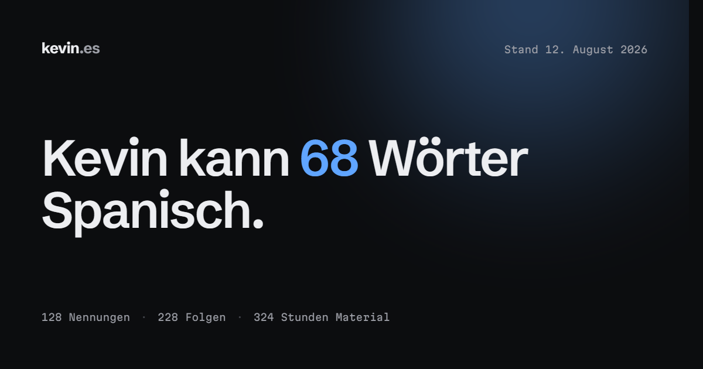

# kevin.es

Source of [wiegutkannkevinspanisch.de](https://wiegutkannkevinspanisch.de), a deadpan tracker of
kevin's active spanish vocabulary, counted from the podcast episode by episode.



No opinions, only receipts: every word links back to the moment it was said.
Fully static, no backend, no cookies, nothing loaded from a CDN.

## how it counts

```
podcast · youtube      german auto-subtitles via yt-dlp (never the translated "es" track)
  → build-data         90 episodes          scan-channels   last N videos
  → lib/spanish.mjs    real words count; loanwords (burrito, tapas …) don't
  → speaker check      subtitles don't know who's talking, a human decides per hit
  → src/lib/data.js    → esbuild + tailwind → static files
```

## run

```bash
npm install
npm run dev        # watch + dev server on :5500
npm run build      # app.js, styles.css, cache stamp in index.html
npm run serve      # zero-dependency static server (PORT overrides)

npm run og         # share image, icons, meta (after every data pass)
npm run zitate     # verbatim quotes → src/lib/zitate.js
npm run extract    # one episode: -- <url | file.vtt> [--folge N]
```

Needs Node 18+. The data scripts also need `yt-dlp` on the path.
Routing is hash-based (`#/…`), so the host needs no rewrites.

## structure

```
index.html          shell, theme tokens, meta
src/
  app.jsx           router, nav, theme, footer
  pages/            home, wortschatz, folgen, soundboard
  lib/              data, zitate, ui, theme, ostereier
scripts/
  build-data.mjs    podcast → data.js
  scan-*.mjs        channel scan and speaker review
  lib/spanish.mjs   the dictionary that decides what counts
  og.mjs            share image
  data/             reviewed hits
assets/fonts/       schibsted grotesk, martian mono
app.js, styles.css  build output, deployed as-is
```

Design: [DESIGN.md](DESIGN.md) · Product: [PRODUCT.md](PRODUCT.md)

---

<sub>Parody, not affiliated with Papaplatte.</sub>
